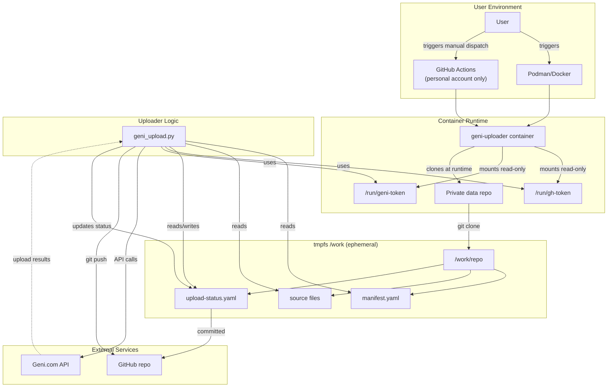

# geni-uploader Architecture

## Overview

The geni-uploader is a containerized, user-run tool for uploading genealogical source documents and photos to Geni.com profiles. It follows a security-by-design principle: the container image is immutable and carries only the reviewed uploader code; the user's private data repository supplies DATA only (manifest, scanned sources, status file), and no code from that repository is ever executed.

## System Architecture



## Components

### 1. Container Image (Immutable)

The published image (`ghcr.io/reihlinstinct/geni-uploader`) contains:
- **Pinned Python environment**: Python 3.11+ with minimal dependencies (`PyYAML==6.0.3`)
- **Reviewed uploader code**: `geni_upload.py` and `source_details.py`
- **Entrypoint script**: `entrypoint.sh` that clones the data repo, runs the uploader, and commits results
- **NO credentials**: Tokens are mounted at runtime, never baked in
- **NO user code execution**: The data repository's code is never executed

### 2. Private Data Repository

User-controlled git repository containing:
- **Manifest**: YAML file defining what to upload (profile IDs, expect names, documents, photos)
- **Source files**: scanned documents and photos (referenced relative to the manifest file)
- **Status file** (`upload-status.yaml`): durable state tracking completed/uncertain/resolved uploads (created and updated by the uploader)

The repository is cloned into a tmpfs (`/work`) at runtime. The clone is ephemeral; the durable record is the status file committed back to the repo.

### 3. Credentials

Two tokens are required, both mounted at runtime (mode 600):
- **GitHub token** (`/run/gh-token`): read/write access to clone the data repository and push status updates back
- **Geni token** (`/run/geni-token` or `GENI_ACCESS_TOKEN` env var): Geni API access for reading profiles and uploading sources

The entrypoint script's `GIT_ASKPASS` helper answers only `github.com` prompts; non-GitHub remotes are refused.

### 4. Geni API

The uploader communicates only with Geni's API (`https://www.geni.com/api`). Every network call passes through an allowlist enforcing permitted (method, kind) pairs. GET requests retry on transient errors; POST requests are never blindly retried.

## Data Flow

1. **Initialization**: The container clones the user's data repository into `/work/repo` (tmpfs). The cloned HEAD is verified against `GENI_UPLOAD_EXPECT_SHA` if provided.
2. **Manifest loading**: The uploader reads the manifest, validates schema, checks that all referenced files exist.
3. **Profile verification**: Each target's `profile_id` is resolved (guid → API node ID, see [docs/guid-resolution.md](docs/guid-resolution.md)) and its `expect_name` is verified against Geni. A failed check aborts before any write.
4. **Plan mode** (`plan`): Fetches each profile's document/photo listings, reports which items would upload and which would be skipped as already present. No writes.
5. **Execute mode** (`run`): For each item not already present:
   - A write-ahead journal intent is fsynced and pushed BEFORE the POST
   - The item is uploaded to Geni
   - The acknowledged object ID is checkpointed BEFORE readback
   - A GET read-back verifies the item appears in the profile's listing, tagged to that profile
   - Items with `also_tag` are tagged to each extra profile, each confirmed by its own GET read-back
   - The status entry records `also_tagged: [...]` for confirmed extra profiles
6. **Status update**: Completed items are recorded in `upload-status.yaml`, which is committed and pushed back to the user's repo (unless `--no-repo-sync` is given). The local state file (`geni-upload-state.json`) is also updated atomically.
7. **Cleanup**: The container exits. The tmpfs is discarded. The durable record is the status file in the user's repo.

## Durable Resume Mechanism

- **Idempotency**: Items already present on Geni are skipped (but only when the profile listing actually shows them).
- **Journaled uploads**: A create intent is committed and pushed BEFORE POST. The acknowledged object ID is committed and pushed BEFORE any tag or readback. Each tag has an intent, acknowledged, and verified phase. Every checkpoint is atomic and fsynced locally; normal container execution requires a successful remote push before continuing. Failure stops.
- **Uncertain items**: A create intent without an acknowledged ID (network failure after send) is marked `uncertain` and the run STOPS (exit 3). The tool never auto-retries an uncertain write. The user must check Geni and set the entry in `upload-status.yaml` to `resolved` (fixed on Geni) or `not_found` (confirmed absent, safe to retry). Deleting the entry does NOT unblock it.
- **Resume**: Run the same command again. Completed items are skipped; interrupted items are retried (only those with no prior intent). Acknowledged tags resume through GET only; only not-yet-attempted tags are sent.
- **429 handling**: A 429 rate limit from Geni stops the run immediately. Pending items remain pending; nothing is auto-retried.
- **Readback**: Allows up to twelve 30-second intervals, paced by the same rate limiter. A pending journal survives lag; an absent listing NEVER triggers recreation.

See [docs/DURABLE_RESUME.md](docs/DURABLE_RESUME.md) and [docs/usage.md § 7](docs/usage.md).

## Security Model

**Threat model** (from SECURITY.md):
- No credentials, tokens, manifests, assets or personal data belong in this repo; it is scanned with GitHub secret scanning + push protection.
- The loader handles secrets only as runtime-mounted files (mode 600) and never prints them.

**Mitigations:**
1. **Immutable image**: The container image is pinned by digest; the loader is pinned by git commit (`GENI_UPLOAD_EXPECT_SHA`) at runtime.
2. **Read-only credential mounts**: Tokens are mounted read-only (mode 600); neither is baked into the image.
3. **Ephemeral tmpfs workspace**: The clone lives in tmpfs (memory); with `--rm` the container never lands in Podman storage.
4. **No user code execution**: The data repository's code is never executed. Only the reviewed uploader runs.
5. **Strict URL validation**: The entrypoint refuses non-GitHub remotes unless explicitly running E2E tests. The `GIT_ASKPASS` helper answers only `github.com` prompts.
6. **Allowlisted API calls**: Every network call passes through `execute()`, which hard-enforces an ALLOWLIST on (method, kind) pairs.
7. **Fail-closed verification**: Each target's identity is verified before any write. Interrupted tags/identities and 429 block further work until explicit reviewed reconciliation.
8. **Safe logging**: Logs never contain tokens, headers, payloads, or personal names/titles (items are logged as short hashes).

## Privacy Considerations

The running tool contacts exactly two services: Geni (`https://www.geni.com/api`) and GitHub (`https://github.com`). There is no application server, no analytics, no tracking, and no communication with any other third party.

**Data locations:**
- **To Geni:** the documents and photos the user places in the upload manifest, with their titles, source references and tags.
- **To the user's Git repository:** `upload-status.yaml` with Geni profile IDs, item titles, timestamps and verification states.
- **On the user's machine:** tokens (files on disk), local state file, diagnostic logs (timestamps, steps, HTTP statuses, short hashes only).

The tool's author receives no data. The tool runs entirely on the user's machine and reports to no one.

See [docs/privacy.md](docs/privacy.md) and [PRIVACY.md](PRIVACY.md).

## Extension Points

**Existing-source metadata repair** (user-only, pending image release): Source repair and private snapshot support is described in [docs/source-details-design.md](docs/source-details-design.md) and [docs/usage.md](docs/usage.md). Only the user, personal account `reihl`, triggers the service workflow. Agents develop/test offline only and never dispatch or schedule it. Existing sources are updated by confirmed API node ID, never recreated. Fact citations remain manual. The new modes stay disabled until a matching immutable image is pinned.

**Profile creation** (design phase, no implementation yet): Design for creating new Geni profiles from a manifest is at [docs/profile-creation-design.md](docs/profile-creation-design.md). See issue #68 for design review.

**Offline companion** (design phase, #93): `geni_offline/` is an empty package reserved for offline-only helpers and a future read-only MCP server. It is not in the container image and never imports `geni_upload` or `source_details`. `tests/test_offline_zero_network.py` enforces that it stays offline: an AST scan forbids network, subprocess and dynamic-import modules, and a child-process audit hook blocks socket, urllib, subprocess and exec/spawn events while every module is imported.

## Testing and Deployment

**Tests:** Install dev dependencies and run the test suite:

```bash
pip install -r requirements-dev.txt
python -m pytest -q
```

**CI:** GitHub Actions workflow `.github/workflows/ci.yml` runs tests on push.

**Image publishing:** See `.github/workflows/publish-image.yml`. The image is published to `ghcr.io/reihlinstinct/geni-uploader`.

## Related Documentation

- [docs/usage.md](docs/usage.md) — Container usage guide
- [docs/DURABLE_RESUME.md](docs/DURABLE_RESUME.md) — Durable source resume
- [docs/guid-resolution.md](docs/guid-resolution.md) — GUID resolution
- [docs/source-details-design.md](docs/source-details-design.md) — Existing-source metadata repair design
- [docs/profile-creation-design.md](docs/profile-creation-design.md) — Profile creation design (design phase)
- [docs/privacy.md](docs/privacy.md) — Privacy policy
- [docs/geni-token.md](docs/geni-token.md) — Geni token guide
- [SECURITY.md](SECURITY.md) — Security policy
