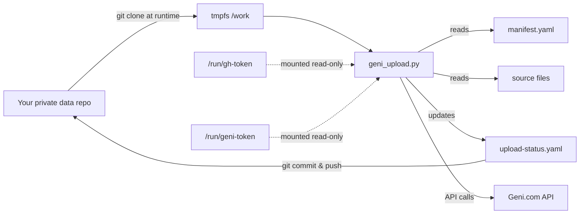

# geni-uploader

[](https://github.com/reihlinstinct/geni-uploader/actions/workflows/ci.yml)

Containerized, user-run uploader for Geni source documents and photos. The image is immutable and carries a pinned, reviewed loader; your private repository supplies DATA only (manifest, scans, status file) and its code is never executed.

**Documentation:** [docs/](docs/)  
**Security:** [SECURITY.md](SECURITY.md)  
**Privacy:** [PRIVACY.md](PRIVACY.md), [docs/privacy.md](docs/privacy.md)

## Architecture



The container image carries the reviewed uploader code. The loader clones your repository into a tmpfs, reads the manifest and sources, uploads to Geni via its API, updates the status file with results, and commits+pushes the status back to your repo. Credentials are mounted at runtime; neither is baked into the image, printed, or committed.

## CLI API

The loader (`geni_upload.py`) provides these commands:

### `auth-url`
Generate the Geni OAuth authorization URL (desktop flow)
- `--client-id` (required): your Geni app's client ID
- `--redirect-uri` (optional): callback URL if your app settings define one; desktop flow (default) needs none

### `whoami`
Verify Geni API credentials (prints authenticated profile). No arguments.

### `plan`
Dry-run mode: reads the manifest, checks what would be uploaded, prints the plan; NO writes to Geni or status file
- `--manifest` (required): path to the upload manifest file
- `--log` (optional): diagnostic log file (plan default: stdout only)

### `run`
Execute the uploads: reads manifest, uploads sources, updates status file
- `--manifest` (required): path to the upload manifest file
- `--confirm` (required): pass `YES` to confirm (run is refused without it)
- `--log` (optional): diagnostic log file (run default: `geni-upload-run.log` next to the state file)
- `--state` (optional): state file path (default: `geni-upload-state.json`)
- `--smoke` (optional): upload only the first item, then stop
- `--no-repo-sync` (optional): do not commit/push upload-status.yaml back to the repo

### `contrast`
Compare server listings against manifest. Shows which items exist on Geni.
- `--manifest` (required): path to the upload manifest file

### `guidmap`
Show the manifest's profile IDs mapped to their resolved API identifiers.
- `--manifest` (required): path to the upload manifest file

### `pguid`
Show each profile's resolved API identifier.
- `--manifest` (required): path to the upload manifest file

See [docs/guid-resolution.md](docs/guid-resolution.md) for the guid resolution mechanism.

## Usage: Local (podman)

### Dry run (plan mode, read-only)

```bash
podman run --rm --tmpfs /work \
  -e GENI_UPLOAD_REPO=https://github.com/<you>/<repo>.git \
  -e GENI_UPLOAD_REF=<branch> \
  -e GENI_UPLOAD_EXPECT_SHA=<full-40-char-sha> \
  -v ~/.gh-token:/run/gh-token:ro,Z \
  -v ~/.geni-token:/run/geni-token:ro,Z \
  ghcr.io/reihlinstinct/geni-uploader@sha256:<pinned-digest> \
  --token-file /run/geni-token plan \
  --manifest packages/my-batch/upload-manifest.yaml
```

`plan` performs only GET requests: it loads the manifest, checks every referenced file, fetches each profile and its document/photo listings, verifies the expected name, and reports which items would upload and which would be skipped as already present.

### Execute mode (run)

Only after a clean plan:

```bash
podman run --rm --tmpfs /work \
  -e GENI_UPLOAD_REPO=https://github.com/<you>/<repo>.git \
  -e GENI_UPLOAD_REF=<branch> \
  -e GENI_UPLOAD_EXPECT_SHA=<full-40-char-sha> \
  -v ~/.gh-token:/run/gh-token:ro,Z \
  -v ~/.geni-token:/run/geni-token:ro,Z \
  ghcr.io/reihlinstinct/geni-uploader@sha256:<pinned-digest> \
  --token-file /run/geni-token run \
  --manifest packages/my-batch/upload-manifest.yaml \
  --confirm YES
```

Useful flags: `--smoke` uploads only the first item, then stops (verify it on Geni before the full run); `--state <path>` relocates the state file; `--no-repo-sync` skips committing the status file back to the repo; `--log <path>` relocates the diagnostic log.

See [docs/usage.md](docs/usage.md) for detailed usage, exit codes, verification, status file semantics, and resume behavior.

## Usage: GitHub Action

The service workflow is manual dispatch only, triggered only by the personal account (`reihl`). Agents develop and test offline only and never dispatch or schedule it. See [docs/privacy.md](docs/privacy.md) for the access policy and workflow execution rules.

## Expected private repository structure

Your private data repository (the one the uploader clones) contains your manifest, source files, and the status file. The manifest can be anywhere in the repo; scanned source files are referenced relative to the manifest's own directory.

**Example layout** (synthetic names only):

```
your-private-repo/
├── packages/
│   ├── batch-01/
│   │   ├── upload-manifest.yaml
│   │   ├── scan-page-01.jpg
│   │   ├── scan-page-02.jpg
│   │   └── upload-status.yaml       # created/updated by uploader
│   └── batch-02/
│       ├── upload-manifest.yaml
│       ├── doc-example.pdf
│       └── upload-status.yaml
└── README.md
```

### English descriptions are mandatory

Every document and photo requires `description_en`: a human-reviewed English
account of the source, its provenance, relevant facts and limits. Include the
source URL when available. Hebrew and the source's original language may be
added in the optional `description` field. The API receives English first,
followed by that supplementary text. `description_en` itself is never an API
field. Missing English fails local validation before any network access.
Mechanical checks reject empty, URL-only and non-Latin-only text; they cannot
prove a text is English or a translation is accurate. Author review remains
required. Old manifests must be migrated deliberately. Do not change the
binding of an uploaded item and rerun it as if it were a new source; use the
separately approved existing-source repair flow instead.

### Manifest schema

One YAML file, for example `packages/my-batch/upload-manifest.yaml`:

```yaml
targets:
  - profile_id: "1234567890123456789"    # the Geni profile number
    expect_name: "ZZ Sample Person"       # >= 2 words; checked against Geni
    documents:
      - title: "Short descriptive title"
        source_url: "https://example.org/source-page"  # or use file:
        description_en: "Describe this source in English, with date, attribution and limits."
        description: "Optional Hebrew or original-language text."
        labels: "source"
    photos:
      - title: "Another scan"
        description_en: "Family-provided scan; describe its evidence and limits in English."
        file: "scan-page-12.jpg"          # relative to THIS manifest file
        also_tag: ["9876543210987654321"]  # optional: tag the SAME object
                                            # to these profiles too
  - profile_id: "9876543210987654321"
    expect_name: "ZZ Second Person"
    documents: []
    photos: []
```

**Schema rules** (enforced by the loader):

- `profile_id` and `expect_name` are required for every target. `expect_name` must be a distinctive full name, not a bare first name.
- `profile_id` is the number from the profile's website URL. That number is usually the profile's **guid**, not its API node id; the tool resolves it automatically (fail-closed, with the name guard) before any other call. See [docs/guid-resolution.md](docs/guid-resolution.md).
- Every item needs a `title`. Documents need `source_url` or `file`; photos need `file`.
- `file:` paths resolve relative to the MANIFEST's own directory (not the repository root), must stay inside that directory, and must exist. Keep scans next to the manifest and reference them by bare filename.
- `also_tag` (optional, per item) is a list of OTHER profile ids from the same manifest. One source scan often belongs on several profiles (a group photo, a shared record): instead of uploading a duplicate object per profile, the item is uploaded ONCE under its own target and the SAME object is tagged to each extra profile. Each extra tag is verified by its own GET read-back.

See [docs/usage.md § 4](docs/usage.md) for the full manifest schema and item rules.

### Status file

The uploader records completed, uncertain, and resolved items in `upload-status.yaml` next to the manifest. The file is committed and pushed back to your repo after each verified upload (unless `--no-repo-sync` is given). Items already present on Geni are skipped on the next run.

**States:** An item can be marked `completed` (uploaded and verified), `uncertain` (network failure after send — the item may or may not exist on Geni; the run stops), `resolved` (fixed on Geni by hand), or `not_found` (confirmed absent, safe to retry). The tool never auto-retries an uncertain write; you must check Geni and set the entry to `resolved` or `not_found` manually.

**Exit codes for run:** 0 = done; 1 = failure (see log); 2 = refused (missing `--confirm YES` or missing token); 3 = an upload's outcome is UNCERTAIN (see above); 4 = a write was acknowledged but the read-back verification failed; 5 = uploads verified on Geni but the status-file push back to the repo failed (the next run retries the sync); 6 = another run holds the lock (concurrent runs are refused).

**429 handling:** A 429 rate limit from Geni stops the run immediately. Pending items remain pending; nothing is auto-retried.

See [docs/DURABLE_RESUME.md](docs/DURABLE_RESUME.md) and [docs/usage.md § 7](docs/usage.md) for durable resume, verification, status file semantics, and reconciliation rules.

## Development

**Tests:** Install dev dependencies and run the test suite:

```bash
pip install -r requirements-dev.txt
python -m pytest -q
```

**Building the image:** See `publish-image.yml` for the publish workflow. The image is published to `ghcr.io/reihlinstinct/geni-uploader`.

## Related documentation

- [docs/usage.md](docs/usage.md) — Container usage guide (manifest schema, plan/run, verification, resume, failures)
- [docs/DURABLE_RESUME.md](docs/DURABLE_RESUME.md) — Durable source resume (journaled upload protocol)
- [docs/guid-resolution.md](docs/guid-resolution.md) — GUID resolution (profile URL → API node ID)
- [docs/source-details-design.md](docs/source-details-design.md) — Existing-source metadata repair and private snapshot design
- [docs/privacy.md](docs/privacy.md) — Privacy policy (what data goes where, retention)
- [docs/geni-token.md](docs/geni-token.md) — Geni token guide (OAuth flow, scopes)
- [docs/index.md](docs/index.md) — Documentation index
- [PRIVACY.md](PRIVACY.md) — Privacy summary
- [SECURITY.md](SECURITY.md) — Security policy and reporting
