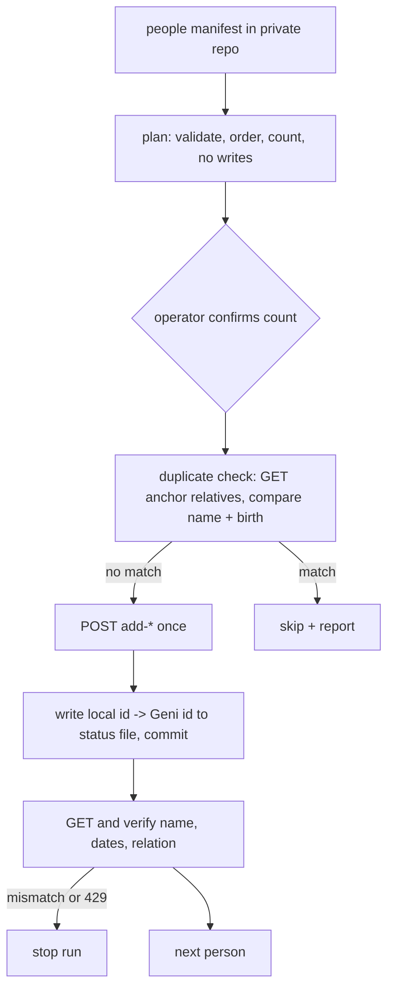

# New-profile creation (people manifest): proposed scope

Version: 0.1, 2026-10-26. Status: design only. No code, no API calls.

## Goal

Let a person who runs the uploader on their own machine add new people to their own Geni tree from a reviewed manifest in their own private git repository, with every write verified by a follow-up GET. First user: a friend building his family tree from scratch (data in a separate private repo; nothing about him or his family in this public repo).

## Documented API surface (geni.com developer help, reviewed 2026-10-26)

- POST profile-<id>/add-child, add-parent, add-partner, add-sibling. Form or JSON. They create a new profile attached to an existing one and return it.
- Fields: first_name, middle_name, last_name, maiden_name, display_name, names{locale:{...}}, gender, is_alive, birth/death/burial/marriage/divorce events, email, nicknames, public, relationship_modifier (adopt/foster).
- No standalone "create unattached profile" endpoint was found. A tree grows outward from an existing profile, normally the operator's own profile.

## Manifest: new `people` type

Per person: local id (stable, in git), name fields (he/en locales), gender, alive flag, optional events, and one edge: relation (child/parent/partner/sibling) plus anchor, where the anchor is either a Geni profile ref already confirmed (for example the operator's own profile) or another local id. Processing order is topological: an anchor exists before anything attached to it.

## Idempotence and safety

- A create is not repeatable. The status file maps local id to returned Geni id and is written durably right after each POST (extends DURABLE_RESUME). An uncertain outcome (timeout, no response) is never retried blindly: the run stops and the next plan GETs the anchor's relatives to reconcile.
- Plan mode is the default. Run requires `--confirm-count N` matching the plan, and a per-run cap (default 10).
- Hard gates kept from today: identity check of the anchor, stop on 429, no unknown request keys.
- Living people: is_alive true and public false by default. A living person is created only if the manifest carries an explicit consent flag recorded in the private repo. Living data never goes to public logs. Logs stay anonymised; the detailed log stays encrypted.
- Only the operator, with their own account and token, triggers runs. Agents develop and test offline against a fake server and never dispatch or call Geni.
- Terms: the Geni general terms restrict AI access and the API agreement restricts data use. Availability of an endpoint does not resolve that; the operator runs it himself, as with source uploads.

## Out of scope

Merging, deleting, editing existing profiles, fact citations, photos for new profiles (separate stage).

## Test plan

Unit: manifest validation, cycle detection, topological order, payload building, locale names. Functional: fake Geni server end to end, resume after kill between POST and status write, duplicate skip, consent gate, cap and confirm-count, 429 stop, mismatch stop. Regression test per bug. Coverage floor 80%.

## Delivery

Issue, this design doc via PR, then implementation PR (minor version bump, CHANGELOG, README schema with invented names). Image build and digest pin only on the user's go; the new mode stays disabled until pinned.
