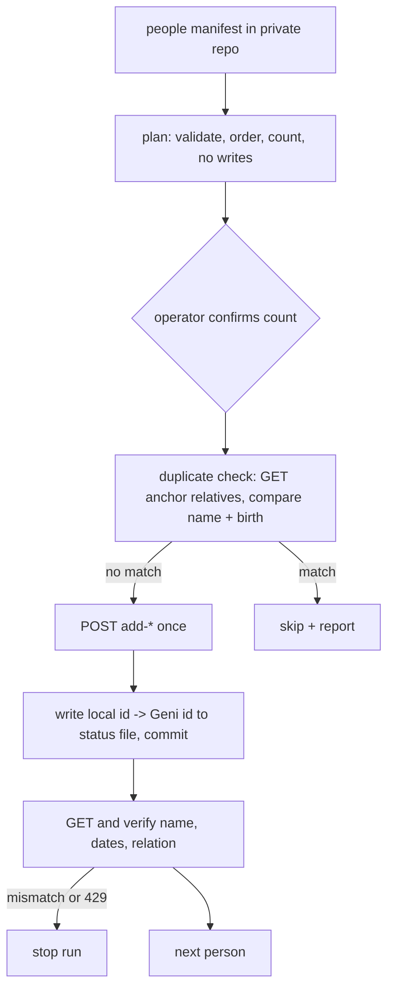

# New-profile creation (people manifest): proposed scope

Version: 0.2, 2026-10-26. Status: design only. No code, no API calls.

## Goal

Let a person who runs the uploader on their own machine add new people to their own Geni tree from a reviewed manifest in their own private git repository, with every write verified by a follow-up GET. First user: a friend building his family tree from scratch (data in a separate private repo; nothing about him or his family in this public repo).

## Documented API surface (geni.com developer help, reviewed 2026-10-26)

- POST profile-<id>/add-child, add-parent, add-partner, add-sibling. Form or JSON. They create a new profile attached to an existing one and return it.
- Fields: first_name, middle_name, last_name, maiden_name, display_name, names{locale:{...}}, gender, is_alive, birth/death/burial/marriage/divorce events, email, nicknames, public, relationship_modifier (adopt/foster).
- No standalone "create unattached profile" endpoint was found. A tree grows outward from an existing profile, normally the operator's own profile.

## Manifest: new `people` type

Per person: local id (stable, in git), name fields (he/en locales), gender, alive flag, optional events, and one edge: relation (child/parent/partner/sibling) plus anchor, where the anchor is either a Geni profile ref already confirmed (for example the operator's own profile) or another local id. Processing order is topological: an anchor exists before anything attached to it. See "Ordering and cycle detection".

## Ordering and cycle detection

Planning builds a graph with one node per local id and one edge from each person to the anchor it depends on. Geni profile refs are roots with no dependencies. Planning makes no network calls.

- Algorithm: Kahn's algorithm (in-degree counting; equivalent to a DFS that aborts on a back-edge, chosen because leftover nodes give the cycle members directly). Ties are broken by manifest declaration order, so the plan is deterministic and reviewable. Each connected component is sorted on its own; components run in declaration order.
- Cycle detection: if nodes remain after the queue empties, they are on or behind a cycle. The plan fails with exit 1 and lists the local ids involved (local ids only, no names). Nothing is written. A self-anchor and an anchor that names an unknown local id fail the same way.
- Cycles can arise by manifest error even though each edge is valid alone (X is child of Y, Y is child of X). The doc does not rely on Geni's API to prevent them.
- A person whose anchor is a Geni ref must have that ref confirmed by the anchor identity check (below) before anything else in the plan is shown.
- Worked example (invented ids): `p1` anchor `geni:operator` (child), `p2` anchor `p1` (partner), `p3` anchor `p2` (child). Order: p1, p2, p3. If `p1` instead anchored on `p3`, none of the three reaches in-degree 0 and the plan reports `cycle: p1, p2, p3`.

## Identifier forms

Geni has two id spaces: the node id (`profile-<N>`) and the guid shown in profile URLs (`profile-g<guid>`); see docs/guid-resolution.md. Rules for this feature:

- The status file stores the id exactly as the API returned it in the POST response, plus the form (`node` or `guid`) it was verified in. A number copied from a URL is never stored or used until its form is verified with the existing identity check (try as given, fall back with the strict name guard, never conflate the spaces). Watch the `profile-` prefix: an id with the prefix and one without must compare equal only after normalisation to the same form.
- Anchors given as a Geni ref in the manifest carry `expect_name`. Plan mode verifies the anchor exists and matches before the rest of the plan is shown, which catches a typo or the wrong profile.
- `profile-g<guid>` works for a single-profile GET, but bulk reads by `ids=` can return empty results for it. Reconcile and verification therefore use single-profile GETs for guid-form ids, and an empty bulk result is never read as "not found".
- Responses that look empty or wrapped (for example `{"results": []}`) are handled fail closed, as in guid-resolution.md: an empty wrapper is an error, not "no relatives".

## Reconciliation after an uncertain write

An uncertain POST (timeout, dropped connection, unparseable response) is never retried. The run stops and the person is marked `uncertain` in the status file, written before the stop.

- Reconcile happens during the next plan, before any new POST. It GETs the anchor's relatives, then compares candidates with a strict predicate: same relation to the anchor, same first and last name after case and whitespace normalisation, and, when the manifest has a birth year, the same birth year. Middle names, suffixes and nicknames do not block a match. Matching is exact; there is no fuzzy year window, because a false match would silently skip a person. Near-matches (same relation and name, different or missing year, or a spelling variant) are never treated as a match and never auto-skipped: the plan lists them as local ids for the operator's manual review.
- Open question to settle offline before implementation: whether the relatives endpoint returns full profiles or only ids. If only ids, each candidate needs one more GET, and the plan prints the call count. All reconcile GETs go through the shared rate limiter and stop on 429.
- Exactly one match: record `{local_id, geni_id, reconciled: true}` and skip the POST. More than one match: stop, the operator decides. No match: the person stays `uncertain` and the plan fails with exit 1 until the operator edits the status file in the private repo to `not_created` (or to the Geni id they found by hand). The tool has no force flag that re-POSTs.
- Reconcile results appear in the private log only. Public output uses local ids and counts.

## Idempotence and safety

- A create is not repeatable. The status file maps local id to returned Geni id and is written durably right after each POST (extends DURABLE_RESUME). An uncertain outcome (timeout, no response) is never retried blindly: the run stops and the next plan GETs the anchor's relatives to reconcile.
- Plan mode is the default. Run requires `--confirm-count N` matching the plan, and a per-run cap (default 10).
- Hard gates kept from today: identity check of the anchor, stop on 429, no unknown request keys.
- Living people (fail closed). Decision of the tree owner's operator, 2026-10-26: living people are allowed when the tree owner requests it; no photos for living profiles.
  - `is_alive` is required for every person. A missing value is a validation error in plan mode, never a default.
  - A person with `is_alive: true`, or with `is_alive` unknown, must carry `requested_by_owner: true`. Missing or false is a validation error, not a skip, so the operator sees it before confirming. A person with no death date and no `is_alive` is treated as living.
  - Only the operator sets `requested_by_owner`, by editing the private manifest. The tool only enforces it and never writes it.
  - Living profiles are created with `public: false`. Open item to check offline in the docs: whether Geni itself refuses `public: true` for living people.
  - Plan output counts living and deceased people separately.
  - Living data never goes to public logs. Logs stay anonymised; the detailed log is encrypted with the existing age key mechanism used for uploader logs.
- Scope: the tree owner's own tree only. Per-run cap (default 10) and plan/dry-run mode stay in force.
- Only the operator, with their own account and token, triggers runs. Agents develop and test offline against a fake server and never dispatch or call Geni.
- Terms: the Geni general terms restrict AI access and the API agreement restricts data use. Availability of an endpoint does not resolve that; the operator runs it himself, as with source uploads.

## Plan output and exit codes

Plan mode prints: total count, living and deceased counts, the topological order as local ids, cycles found, validation failures (missing flags, unknown anchors), reconcile results, and the API call count a reconcile would need. It prints no names, dates or Geni ids. Exit 0: plan valid (and, in run mode, `--confirm-count` matches). Exit 1: validation or cycle failure. Exit 2: count mismatch. Exit 4: verification error (existing code). Exit codes for 429 stay as today.

## Failure walk-throughs

- Partial run: persons 1 to 3 succeed, person 4 hits 429. The status file has 3 done and person 4 `uncertain` if the POST may have landed, or `not_started` if the 429 came before it. The next plan reconciles person 4, then continues.
- POST returns an id but the GET shows a wrong name or relation: exit 4, no retry, the person is marked `unverified`, the operator reviews on Geni.
- Duplicate found at the pre-POST check: skip and report; the matched id goes to the private log only.
- Kill between POST and status write: same as uncertain.

## Rollback

There is no automated undo, and the documented API surface has no delete. This is a stated non-feature. Manual undo is the operator's, in the Geni web UI. The safeties are plan mode, `--confirm-count`, and the per-run cap. The README will say this plainly.

## Manifest versioning

The manifest carries `schema_version: 1`. The tool refuses unknown versions.

## Privacy checks

The status file (local id to Geni id, consent flags) lives only in the private repo. The commit step refuses to write it to a repository that is public. Public logs use the existing anonymised RunLog pattern: local ids, counts, outcomes.

## Out of scope

Merging, deleting, editing existing profiles, fact citations, photos for new profiles (separate stage). Explicit non-goal: no photo editing or upload for living people's profiles; the tool only creates them.

## Test plan

Unit: manifest validation (required fields, `is_alive`, consent gate, schema_version), cycle detection and topological order (the worked example above), the duplicate predicate, node-id vs guid handling, payload building, locale names. Functional, against a fake Geni server: end to end; kill between POST and status write, then reconcile finds a match; reconcile finds none (plan fails, no re-POST); POST ok but GET mismatch (exit 4); 429 on any call stops at once; living person without the flag fails validation; cap and confirm-count (exit 2); reconcile GETs paced and counted. Regression test per bug. Coverage floor stays at the existing 80%.

## Delivery

Issue, this design doc via PR, then implementation PR (minor version bump, CHANGELOG, README schema with invented names). Image build and digest pin only on the user's go; the new mode stays disabled until pinned.
