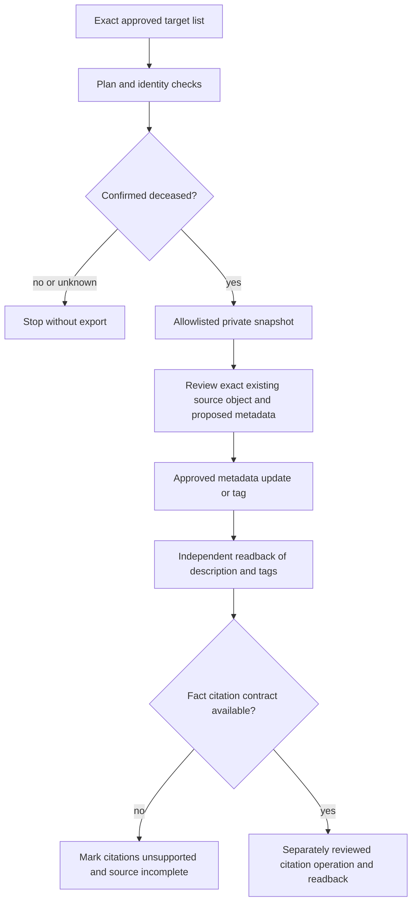

# Source detail and private read support: proposed scope

Version: 0.1, 2026-10-25. Target: initial implementation by 2026-10-26.

Status: design and offline implementation. No agent API calls, dispatch or data changes.

## Current behavior

The loader can add a document or photo with a description, then tag the same object to several named target profiles. Its plan command fetches profile information and document/photo lists to check identity and avoid duplicate uploads. These internal reads are not a supported export command.

The loader does not update an existing source object's metadata, write fact citations, export a private profile snapshot, or read back fact-to-source links. A source attached to a profile is not proof that its facts are cited.

## Documented API surface

- GET profile returns name fields, is_alive, birth, death and burial event data.
- GET document returns title, description, date, source URL, tags and image sizes.
- POST document/update accepts title, description, date and labels.
- POST document/tag/profile tags a person in an existing document.
- POST photo/update accepts title, description and date.
- No fact-citation read or write contract has been established from the documentation reviewed. This must remain an explicit unsupported result, not a simulated success.
- A photo Event field is not listed in the reviewed update contract. Do not place an invented field in requests.

## Proposed stages

1. Contract and safety tests using local synthetic fixtures only. Do not invoke the production API as a test.
2. An explicit private snapshot command for an exact list of existing, confirmed-deceased profiles. Check is_alive before exporting data. Reject living, missing or ambiguous status. Do not recurse into relatives. Output to a private file, not logs or public artifacts.
3. A separate update-existing-source command accepting an exact object ID, expected old title/source URL, approved new metadata and approved target IDs. Verify before and after, never recreate, delete, untag or blindly retry an uncertain mutation.
4. Fact-citation support only after a documented contract or a specifically reviewed supported API mechanism is found. Until then, mark a source with missing citations as incomplete and report why.

Each operation must identify the approved target and proposed fields before execution. Description, profile tags and fact citations must be verified independently. Unknown JSON keys must not be accepted as a new mutation mechanism.

## Privacy and operating limits

The user supplies exact targets from private git data and personally triggers the manual workflow_dispatch GitHub Actions workflow against his own account. The service workflow has no schedule, push, pull_request or repository_dispatch trigger. It requires the verified personal operator account for both actor and triggering_actor, not the automation repository owner. No agent-held token may invoke it. Agents develop and test offline only. Agents never dispatch or schedule the workflow and do not inspect live output unless the user shares it. Development does not authorize live service access. The API agreement grants limited application rights and imposes data-minimization and network-visibility restrictions. The general service terms separately restrict AI access and proxies. Do not treat an available endpoint, user approval or deceased profile as resolving those terms. Do not route around a challenge.

Private snapshots must exclude living relatives embedded in nested profile data. Allowlisted field selection, local file mode0600, no payload logging, no public CI artifacts and no automatic sharing. Diagnostics contain only types, counts and hashes.

## Test plan

- Correct deceased profile and exact target ID succeed in the local fake server.
- Living, absent is_alive and unrecognized envelope fail closed without export.
- Foreign or nested living data never reaches the output file.
- Existing-object mismatch aborts before any write.
- Same source tagged to multiple profiles stays one object.
- Metadata updates preserve unspecified fields and existing tags.
- Timeout or malformed response after write marks uncertain and stops.
- Readback compares description and tags independently.
- Citations unsupported cannot be reported complete.
- No new profile, delete, untag, undocumented Event or citation endpoint enters the allowlist.
- Throttling, wrong pin and expected-SHA mismatch stop without fallback.

## Sources

- https://www.geni.com/platform/developer/help
- https://www.geni.com/platform/developer/help/terms?version=1
- https://www.geni.com/company/terms_of_use
- https://www.geni.com/platform/developer/help/api?path=profile&version=1
- https://www.geni.com/platform/developer/help/api?path=document&version=1
- https://www.geni.com/platform/developer/help/api?path=document%2Fupdate&version=1
- https://www.geni.com/platform/developer/help/api?path=document%2Ftag&version=1
- https://www.geni.com/platform/developer/help/api?path=photo%2Fupdate&version=1

## Flow

## Delivery gates

Mock-tested implementation, green code-only CI, reviewer approval, published immutable image and matching workflow pin are required before the user runs it. No production credential enters CI. The existing Actions minutes restriction may prevent a private-repository run until 1 November; do not pay to bypass it. The public code CI can run without a production call.

## Source ID boundary

Source webpage GUIDs are recorded separately from API node IDs. The repair
command accepts a confirmed API node ID only and compares the returned object
ID. It does not invent a document-g/photo-g mapping. A data item whose API ID
has not been confirmed remains blocked, even if its webpage link is known.
The first release must not silently recreate such an object.
